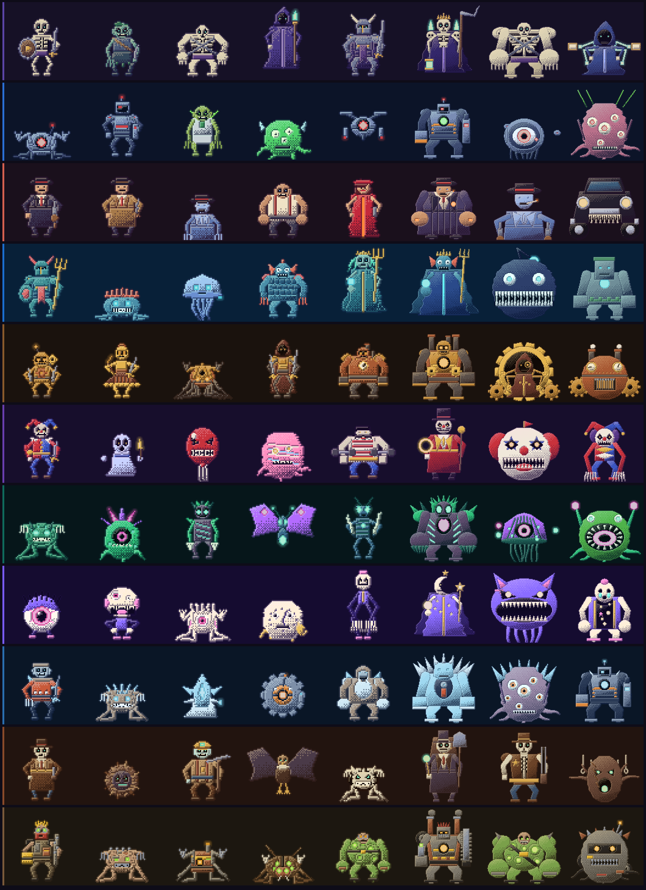
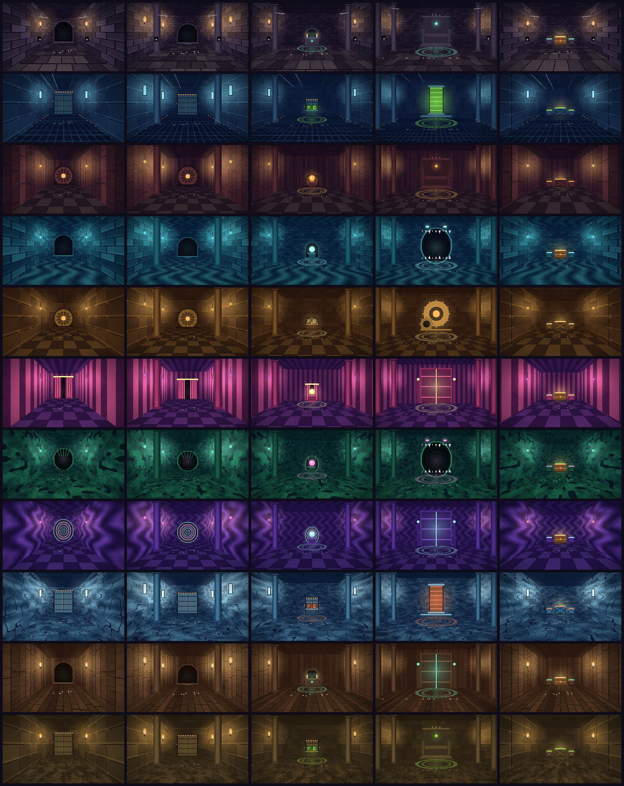
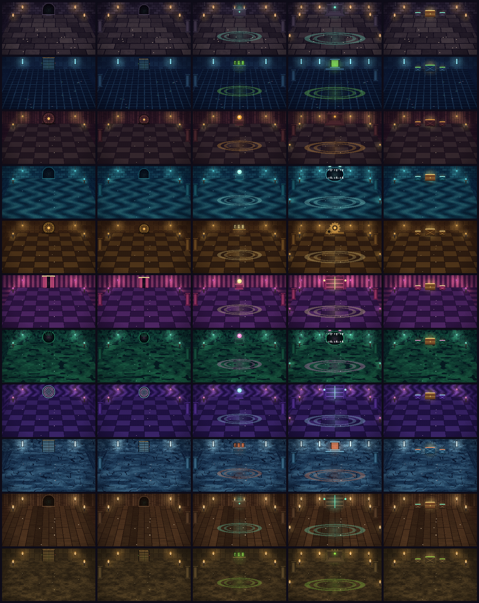

# Pixel art: bestiary, heroes, and interface kit

Front-facing pixel-art monster sprite sheets for the first-person dungeon view, one folder per theme under
`frontend/public/art/monsters/`. Every theme has 5 monsters and 3 bosses. Every creature has `idle`, `hit`,
`attack`, `special` and `death` animations.



## Roster

| Theme ID | Theme | Monsters | Bosses |
| --- | --- | --- | --- |
| `catacombs` | Forgotten Catacombs | Restless Sentinel, Drowned Scout, Bonebound Guardian, Hooded Wraith, Gravebound Sentry | Crypt Warden, Ossuary Colossus, The Pale Archivist |
| `scifi` | Sci-Fi Research Facility | Sentry Crab, Security Bot, Mutated Subject, Vat Specimen, Sentry Drone | Containment Unit-9, The Overseer, Patient Zero |
| `mobster` | 1930s Mobster Underworld | Goon Gunner, Trenchcoat Hitman, Spectral Enforcer, Syndicate Bruiser, Velvet Viper | The Don, Spectral Kingpin, The Black Sedan |
| `sunken` | Sunken Kingdom | Drowned Knight, Reef Lurker, Ghost Jelly, Tide Brute, Drowned Siren | The Drowned King, Abyssal Angler, Ancient Guardian |
| `clockwork` | Clockwork Empire | Windup Scamp, Gilded Dancer, Cogwork Spider, Brass Assassin, Boiler Brute | Brass Colossus, The Clockmaker, Leviathan Boiler |
| `carnival` | Haunted Carnival | Jester Cutthroat, Carousel Specter, Balloon Horror, Cotton-Candy Ooze, Midway Strongman | The Ringmaster, The Laughing Big Top, Harlequin Horror |
| `jungle` | Alien Jungle | Lumen Stalker, Spore Bloom, Thorn Walker, Lantern Moth, Razor Mantis | Heartroot Titan, Mother Lantern, The Apex Maw |
| `dreamscape` | Dreamscapes | Wandering Eye, Chatterhead, Palm Crawler, Hourless Slug, Stilt Walker | Sovereign of Sleep, The Hungry Grin, The Hollow Child |
| `arctic` | Arctic Station | Frostbitten Researcher, Husk Hound, Ice Wraith, Ice-Saw Drone, Rimefur Brute | Glacier Titan, The Thing in the Ice, Cryo Warden |
| `ghosttown` | Ghost Town | Revenant Gunslinger, Tumbleweed Haunt, Cursed Prospector, Carrion Vulture, Phantom Coyote | The Undertaker, Sheriff of the Damned, The Hanging Tree |
| `wasteland` | Post-Apocalyptic Settlement | Scrap Raider, Rust Hound, Jury-Rigged Flamer, Rad-Roach, Bloated Brute | Warlord's War-Rig, Fallout Behemoth, The Scrap-Heap King |

## Files

```
frontend/public/art/monsters/
  index.json                 # all themes, frame columns, animation order
  <theme>/manifest.json      # palette, creatures, per-animation timing
  <theme>/<creature>.png     # sprite sheet (RGBA, transparent background)
  <theme>/preview.png        # contact sheet for quick review
```

Served by Vite at `/art/monsters/...`.

## Sprite sheet layout

One row per animation, in this order, six columns per row (unused cells are transparent):

| Row | Animation | Frames | FPS | Loops | Notes |
| --- | --- | --- | --- | --- | --- |
| 0 | `idle` | 4 | 6 | yes | Subtle breathing/hover; the resting state in a formation |
| 1 | `hit` | 2 | 12 | no | White flash plus recoil when damaged |
| 2 | `attack` | 6 | 10 | no | Telegraph, strike, recovery. `impactFrame` is 3: apply the hit effect on that frame |
| 3 | `special` | 6 | 10 | no | The creature's signature move (stance, wail, summon, cast). `impactFrame` is 3 |
| 4 | `death` | 6 | 8 | no | Ends on its last frame (`hold: true`); the final frame is rubble, nothing, or a faded remnant |

Monsters use 64x64 frames (sheet 384x320). Bosses use 128x128 frames (sheet 768x640). All creatures anchor at
bottom-centre: `anchor` in the manifest is the floor contact point (`x = size/2`, `y = size-3`). Draw sprites
with `image-rendering: pixelated` and scale by whole integers.

Each creature entry in the manifest also carries `name`, `tier` (`monster` or `boss`), `role`, `attack` and
`special` (display names for telegraphs), and the `move` and `style` hints used to pick matching effects.

## Using a sprite

```ts
const m = await (await fetch("/art/monsters/sunken/manifest.json")).json();
const c = m.creatures.find((x) => x.id === "drowned_knight");
const a = c.animations.attack;                 // { row, frames, fps, loop, impactFrame }
// frame i of animation a is at: x = i * c.frame.w, y = a.row * c.frame.h
```

## Design rules

- Front-facing, centred, readable silhouettes, because the party views enemies head-on in first person.
- Consistent pixel density: bosses are drawn at 2x the monster canvas, not at a coarser pixel size.
- Per-theme palette, with emissive eyes and cores for readability in dark rooms.
- Telegraph and response: `attack` and `special` wind up visibly before the impact frame, matching ADR 0018.
- Reduced motion: hold `idle` frame 0 and skip to the `impactFrame` pose; do not rely on animation alone for state.

## Heroes

One front-facing hero per class under `frontend/public/art/heroes/`, drawn with the same rigs and shading as the
monsters (`scripts/pixel-art/heroes.mjs`). Ids match the backend class catalog: `bulwark`, `juggernaut`, `spellguard`,
`assassin`, `arcanist`, `ranger`, `cleric`, `tactician`, `beastcaller`.

```
frontend/public/art/heroes/
  manifest.json                    # frame size, animations, hero list, skin tiers and variants
  <class>/t<tier>-<variant>.png    # 384x384 sheet, 64x64 frames, one animation per row (see the table below)
  <class>/t<tier>-<variant>-bust.png  # 32x32 head-and-shoulders crop for roster portraits
  empty.png                        # 256x64 silhouette idle (4 frames) for open party slots; empty-bust.png to match
```

Frames are 64x64 and anchor bottom-centre like monsters. `docs/art/heroes.png` shows every hero in every row at tier 6.

### Mastery tiers and colour variants

Every class has six armour tiers, earned through class mastery. Every tier comes in every colour variant, and each
combination has a full sheet with every animation row. `draw(c, p, s, tier)` in `heroes.mjs` escalates the look:

| Tier | Rank | Mastery | Look |
| --- | --- | --- | --- |
| 1 | Recruit | 1 | Homespun and wood; drab, faded colours; nothing glows |
| 2 | Journeyman | 2 | Plain iron and leather, first trims |
| 3 | Veteran | 4 | The classic look of each class |
| 4 | Champion | 7 | Layered pauldrons, trimmed capes, glowing emblems |
| 5 | Exalted | 11 | Spikes, horns and helm wings, floating orbs, glowing weapon edges |
| 6 | Ascendant | 16 | Crowns, halos, wings and spirit companions over a turning ground sigil with rising motes |

Colour variants are dyes over each class's material roles (`roles` in `heroes.mjs`: primary, dark, secondary, metal)
plus the shared gold trim and the glow. They are `heraldic` (the class's own colours, rank 1), `ember` (3), `frost` (6),
`dusk` (9) and `voidstar` (20). Unlock levels and set names live in `backend/internal/game/class_skins.go`, which the
server uses to validate a player's chosen look. Its tests check that the catalog matches the generated manifest.
Every tier of a class is drawn at one scale, fitted to its tier 6 look, so the hero stands the same height at every
tier. `docs/art/hero-tiers.png` shows each class across all six tiers, and `docs/art/hero-variants.png` shows every
variant at tiers 3 and 6.

| Row | Animation | Frames | Use |
| --- | --- | --- | --- |
| 0 | `idle` | 4, loops | Default |
| 1 | `flourish` | 6, once | The class's signature move; played when a player confirms the class |
| 2 | `hurt` | 4, once | Played on a portrait when damage lands |
| 3 | `injured` | 4, loops | Health at 35% or less |
| 4 | `poisoned` | 4, loops | Reserved: no rule applies poison yet |
| 5 | `down` | 2, loops | Health at zero |

Status effects that can combine are not baked into the hero. They are overlays in `ui/status-fx.png` (64x64 cells
that line up with a hero cell, 6 columns): rows `heal` (6 frames, once), `guard`, `ward`, `buff`, `poison`, `sleep`
(4 frames each, looping). `HeroSprite` and `StatusFx` in `frontend/src/lobby.tsx` play both.

## Interface kit

`scripts/pixel-art/ui.mjs` writes `frontend/public/art/ui/`. Everything is authored at 1x; scale by a whole number.

| File | Size | Use |
| --- | --- | --- |
| `frame-panel.png` | 24x24, slice 6 | Main panels (`border-image`, with `fill`) |
| `frame-view.png` | 32x32, slice 10 | Viewport frame with gold corner brackets; the centre is transparent |
| `status-fx.png` | 64x64 cells, 6 columns | Hero status overlays (see Heroes) |
| `frame-inset.png`, `frame-selected.png` | 16x16, slice 4 | Recessed slots, inputs, roster cells; gold selected state |
| `button.png`, `button-primary.png`, `button-danger.png` | 16x16, slice 5 | Buttons with a 2px lip |
| `tile-wall.png`, `tile-floor.png` | 32x32, 32x16 | Seamless backdrop brickwork and the floor heroes stand on |
| `torch.png` | 4 frames of 16x32 | Wall torch, 8 fps |
| `emblem.png` | 32x32 | Game crest |
| `icons.png` | 16x16 cells in one row | Order is listed in `ui/manifest.json` under `icons.order` |

Icons are authored as small character maps in `ui.mjs` (one letter per material) and shaded by the engine. The CSS that
uses the kit is `frontend/src/lobby.css` (kit classes and the lobby) and `frontend/src/run/run.css` (the run screen); `ui/manifest.json` also records the kit's colours.

## Regenerating

The art is produced deterministically by code in `scripts/pixel-art/` (no external tools or network needed).
Creature definitions live in `scripts/pixel-art/themes/<theme>.mjs`.

```
npm run art:build     # regenerate every monster sheet, manifest, index and preview, then heroes and the interface kit
npm run art:verify    # fail if art is stale, a frame is empty or clipped, or a roster rule is broken
npm run art:gallery   # regenerate docs/art/heroes.png, hero-tiers.png, hero-variants.png and bestiary.png
```

`art:verify` enforces: unique creature ids, at least 5 monsters and 1-3 bosses per theme, sheets byte-identical
to a fresh render, correct dimensions, no empty frames, no clipping of idle/hit frames, and an idle loop that
actually animates. Oversized creatures are automatically scaled down (same pixel density) until their idle and
hit frames fit their cell. It also checks that hero and interface
files are not stale and that hero idle frames are unclipped and animate for every tier and variant, and that each tier looks different from the one before it. Run `art:build` and commit the output after
changing any theme, hero, or interface file.

## Backend registry

`npm run art:build` also writes `backend/internal/art/sprites_gen.go`, the Go registry of every theme and sprite. Backend content must reference art through
its exported variables (`art.SunkenDrownedKnight`); the ids cannot be forged or misspelled, so a monster that needs art which does not exist fails to
compile. Monsters are declared with `defineMonster(sprite, MonsterDefinition{...})`. See ADR 0023. Commit `sprites_gen.go` together with the art.
Enemy snapshots carry the sprite as `sprite: "<theme>/<creature>"`, which maps to `/art/monsters/<theme>/<creature>.png`.


## Using the sprites in the frontend

`frontend/src/monsters/` and `frontend/src/fx/` render the sheets and play combat effects (ADR 0024). Inside a scene's
`<svg viewBox="0 0 1100 620">` mount:

```tsx
<EnemyStage view="player" /* or "cast" */ enemies={enemies} events={run.lastCombatEvents ?? []} target={id} onTarget={setTarget} />
```

`enemies` need `id, name, hp, maxHp, x, sprite` and the raw `rawIntent`; `sprite` is the enemy snapshot's `"<theme>/<creature>"`.
Sheets are drawn with integer scaling (monster 5x / boss 3x in the player view, 3x / 2x in the cast view), anchored at the
manifest anchor on the floor, and enemies without a `sprite` get a placeholder silhouette.

How a creature's animations are used:

| Animation | Played when |
| --- | --- |
| `idle` | resting loop |
| `attack` / `special` wind-up | while the enemy's intent is shown: frames before `impactFrame` play once, then hold |
| `attack` / `special` | when the round resolves; effects spawn on `impactFrame` |
| `hit` | the enemy takes damage (with a shake and white flash) |
| `death` | the enemy is defeated; the last frame is held |

An intent plays `special` if its label equals the creature's `special` name, `attack` if it equals the `attack` name; otherwise
party-wide and healing intents and the kinds `wail`, `sweep`, `cloud`, `special_strike`, `soul_sweep`, `soul_drain` play
`special`, and everything else plays `attack` (`monsters/moves.ts`). Keep `attack`/`special` names in the art manifests identical to
the server's ability labels so the first two rules decide it.

The `move` hint on `attack`/`special` (`slash`, `claw`, `smash`, `cast`, `shoot`, `roar`, `wail`, `spit`, `summon`, ...) and keywords in
the move label choose the effect and its element (frost, fire, acid, shock, spectral, arcane; `fx/elements.ts`). With
`prefers-reduced-motion` sprites hold a still frame and effects become short static markers.

## Room backdrops

Every theme also has pixel-art room backgrounds in `frontend/public/art/rooms/<theme>/`: five kinds (`entry`,
`corridor`, `event`, `boss`, `vault`) in two views (`<kind>-first.png`, a first-person view, and `<kind>-cinema.png`, the
elevated spectator view), 275x155 each, shown at 4x. Catacombs and Sci-Fi have hand-authored props; the other nine themes
have their own palettes, surface patterns, light fixtures, doors and set pieces. The enemy standing area and the
foreground floor are kept clear.




```
npm run art:rooms           # regenerate PNGs, manifests, index.json and backend/internal/art/rooms_gen.go
npm run art:rooms:verify    # fail if stale/missing/extra, non-deterministic, flat or cluttered (runs in CI)
npm run art:rooms:gallery   # regenerate docs/art/rooms-first-person.png and rooms-cinematic.png
```

Rendering code and per-theme styles live in `scripts/pixel-art/rooms/` (`styles.mjs` is data, `painter.mjs` the
per-pixel renderer, `props.mjs` the props and layouts). The Go registry (`art.BackdropFor`, `art.RoomKind*`) and
`game.RoomBackdropKind` tie rooms to backdrops; a playable theme whose floors contain a room without a background fails
`go test`. See ADR 0025. The themed encounter catalog now has 73 encounters (`scifi-breach` is new).
